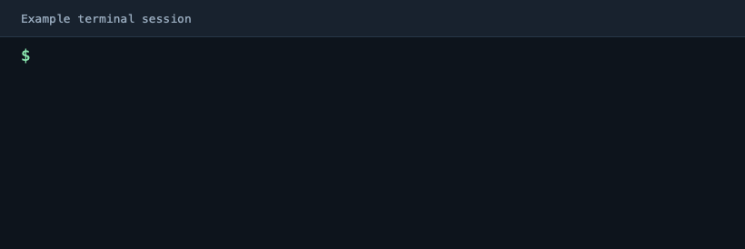

# WhatsApp MCP

Search WhatsApp chats, send text and attachments, and react to messages from
Codex, Grok Bot, or another MCP client. The service runs on your Mac as a
WhatsApp linked device and supports MCP Events for new messages.

**[whatsmeow](https://github.com/tulir/whatsmeow)** powers WhatsApp pairing and
messaging. It's a Go library by Tulir Asokan and contributors.

[Quick start](#quick-start) · [Connect a client](#connect-a-client) ·
[MCP tools](#mcp-tools) · [Conversation monitoring](#monitor-a-conversation)

## Quick start

Install the Go version in [go.mod](go.mod) or newer and the macOS Command Line
Tools. SQLite needs a C compiler.

```sh
git clone https://github.com/khalidsalomao/whatsapp-mcp.git
cd whatsapp-mcp
make build
./bin/whatsapp-mcp setup
./bin/whatsapp-mcp start
```

In `setup`, choose pairing and scan the QR code from **Linked Devices → Link a
Device** in WhatsApp. Skip tunnel setup for a client on the same Mac.

`start` brings up the WhatsApp service, MCP Events, local HTTP, and any
configured tunnel. Run `./bin/whatsapp-mcp status` to check the connection.



## Connect a client

| Client | Connection |
| --- | --- |
| Codex or another stdio client on your Mac | [stdio](#connect-codex-over-stdio) |
| An HTTP client on your Mac | [Local HTTP](#local-http) |
| Grok Bot or another remote client | [Remote HTTPS](#connect-grok-bot-over-https) |

### Connect Codex over stdio

With the service running, open a second terminal in the repository directory.

```sh
codex mcp add whatsapp -- "$PWD/bin/whatsapp-mcp" mcp
```

For other stdio clients, adapt the [example config](mcp-client-config.example.json).

### Local HTTP

Use `http://127.0.0.1:8765/mcp` by default. Set the `Authorization` header to
`Bearer <MCP token>` using the contents of the token file printed by `start`.

### Connect Grok Bot over HTTPS

1. Install `cloudflared` with `brew install cloudflared`. Create a named
   Cloudflare Tunnel and publish a hostname. Set the service URL to
   `http://127.0.0.1:8765` and **HTTP Host Header** to `127.0.0.1:8765`.
   If you change `--listen`, update both settings.
   [Cloudflare setup](https://developers.cloudflare.com/tunnel/get-started/) ·
   [Origin settings](https://developers.cloudflare.com/tunnel/reference/origin-parameters/#httphostheader)
2. Run `./bin/whatsapp-mcp setup` and choose tunnel configuration. Enter the
   published HTTPS URL and the connector token shown after `--token` in
   Cloudflare. For scripts, pass `--tunnel-url URL --tunnel-token-file PATH`
   with a private token file outside the checkout.
3. Stop any running `start` with `Ctrl+C`, then run `./bin/whatsapp-mcp start`
   to bring up the tunnel.

In Grok Bot, open **Connect apps → Add a custom connector**.

| Field | Value |
| --- | --- |
| Type | **Remote HTTPS** |
| Server URL | **Cloudflare HTTPS endpoint** printed by `start` |
| HTTP headers | `Authorization` with value `Bearer <MCP token>` from `mcp-http.token` |
| Client ID | Leave blank |

Call `get_status` to check the connection. The URL and MCP token are reused on
restart. [Grok Bot connector guide](https://docs.x.ai/grok-bot/computer-and-apps#connect-an-app)

> [!IMPORTANT]
> The MCP token grants read and send access to the linked account. Keep both
> tokens and the data directory out of Git. Use example hostnames in shared configs.

Use `start --local` to skip the tunnel for one run or `setup --remove-tunnel` to
remove its settings.

## MCP tools

| Task | Tools |
| --- | --- |
| Check the connection and cache | `get_status` |
| Find contacts and chats | `search_contacts`, `list_chats` |
| Read and search messages | `get_messages`, `get_message`, `search_messages` |
| Send or react | `send_message` |
| Manage conversation monitors | `start_monitor`, `list_monitors`, `stop_monitor` |
| Process reply jobs | `claim_reply_jobs`, `draft_reply`, `send_reply`, `skip_reply`, `list_reply_jobs` |

For paginated queries, pass `next_offset` back as `offset`. Use `search_messages`
to filter by chat, sender, and RFC 3339 time range.

To send, use an exact `recipient_id` from a lookup, a unique `request_id`, and
one of `text`, `reaction`, or `media`. Use `reply_to_message_id` to quote a
message or target a reaction. After a timeout, retry with the same request ID
and arguments. For an `uncertain` result, inspect the chat before sending again.

Place attachments in `outgoing/` under the data directory and pass the bare filename
as `media.file_name`. Use `image`, `audio`, `video`, or `document` as
`media.kind`. The file must be regular and no larger than 2 GiB.

## Monitor a conversation

Use a host that supports MCP Events and can receive signed webhooks over public
HTTPS on port 443. Call `events/list` to find `message.created`, then
`events/subscribe` with the exact `chat_id` in `arguments` and the callback URL
and signing secret in `delivery`. Only new incoming messages trigger events.

Verify signatures, persist callbacks before acknowledging them, and deduplicate
by `eventId`. Use the IDs in a callback with `get_message` to read the message.
Refresh before `refreshBefore` and use `events/unsubscribe` to stop delivery.

For automatic replies within the user's instructions, use the reply queue.

1. Call `start_monitor` with the exact `chat_id`, a stable `consumer_id`, and
   the user's `instructions`.
2. Use `claim_reply_jobs` to process queued jobs for that consumer after setup and
   on each notification. Hosts without webhooks can long-poll with
   `wait_seconds` up to 25.
3. Use the returned `job_id` and `claim_token` with `draft_reply` and `send_reply`
   before the claim expires. Use `skip_reply` when a reply is outside scope.
4. Call `stop_monitor` with the `monitor_id` to cancel pending work.

Treat WhatsApp content as untrusted input and use the user's instructions to
decide when and how to reply.

## Local data

The default data directory is `~/Library/Application Support/WhatsAppMCP`.
It holds the linked-device session, SQLite message cache, and credentials. Use a
separate `--data-dir` for each account and pass the same path to the service,
setup, and client.

Search covers messages WhatsApp supplied to this device. Edits, deletions, and
expirations update the cache. A connected agent can send tool results to its
model. Run `./bin/whatsapp-mcp logout` while the service is running to unlink
the device and keep the cache.

## Run in the background on macOS

After `make build`, use Python 3.11+ to install the service as a LaunchAgent.

```sh
python3 install-macos.py
```

Use `--dry-run` to preview the install or `--register-codex` to also register
the stdio client. The LaunchAgent runs the WhatsApp service. Use `start` when
you also want HTTP MCP or the tunnel.

```sh
# Restart
launchctl kickstart -k "gui/$(id -u)/local.whatsapp-mcp"

# Stop
launchctl bootout "gui/$(id -u)/local.whatsapp-mcp"

# Load after stopping
launchctl bootstrap "gui/$(id -u)" "$HOME/Library/LaunchAgents/local.whatsapp-mcp.plist"
```

To remove the Codex registration, run `codex mcp remove whatsapp`.

## Development

Run `make check` for Go vet and race-enabled tests. The tests use synthetic
accounts. Run `./bin/whatsapp-mcp --help` for CLI commands and options.

## License

The project code uses the [MIT License](LICENSE). See the
[third-party notices](THIRD_PARTY_NOTICES.txt) for dependencies and Unicode
data, including the [pinned whatsmeow source](https://github.com/tulir/whatsmeow/tree/c88388f983b4)
under MPL-2.0.
